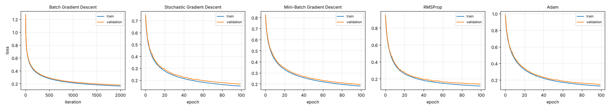

# Random Forest & Softmax Regression (Multi-class Classification)

Predicting the **price range of a mobile phone** (4 classes) using a **Random Forest** and **Softmax Regression**
trained with five optimizers. The softmax model, the optimizers and the metrics are implemented **from scratch with NumPy**;
the Random Forest uses scikit-learn.

## Dataset
[Mobile Price Classification](https://www.kaggle.com/datasets/iabhishekofficial/mobile-price-classification) from Kaggle (`train.csv`).

| Property | Value |
|---|---|
| Samples | 2000 phones |
| Features | 20 (battery_power, ram, px_height, px_width, int_memory, ...) |
| Target | `price_range`: 0 = low, 1 = medium, 2 = high, 3 = very high |
| Classes | 500 phones in each class (balanced) |

## Repository structure
```
├── data/
│   └── train.csv
├── notebooks/
│   ├── 0_random_forest.ipynb
│   ├── 1_softmax_gradient_descent.ipynb
│   ├── 2_softmax_sgd.ipynb
│   ├── 3_softmax_mini_batch_gd.ipynb
│   ├── 4_softmax_rmsprop.ipynb
│   └── 5_softmax_adam.ipynb
├── images/
│   └── loss_comparison.png
├── requirements.txt
└── README.md
```

## Method
1. **Split:** 60% train (1200), 20% validation (400), 20% test (400)
2. **Random Forest:** the validation set is used to choose the number of trees and the max depth
3. **Softmax Regression:** standardization (fit on train only) → bias column → one-hot labels → cross-entropy loss, trained with Batch GD, SGD, Mini-Batch GD, RMSProp and Adam. Train and validation loss are tracked every epoch
4. **Metrics (test set):** Accuracy, macro Precision, Recall and F1, confusion matrix

## Results

| Model | Validation Acc. | Test Acc. | Precision | Recall | F1 |
|---|---|---|---|---|---|
| Random Forest | 0.865 | 0.865 | 0.867 | 0.868 | 0.867 |
| Softmax + Batch GD | 0.953 | 0.970 | 0.970 | 0.971 | 0.970 |
| Softmax + SGD | 0.943 | 0.968 | 0.967 | 0.968 | 0.968 |
| Softmax + Mini-Batch GD | 0.943 | 0.970 | 0.970 | 0.971 | 0.970 |
| Softmax + RMSProp | 0.945 | 0.970 | 0.970 | 0.971 | 0.970 |
| Softmax + Adam | 0.943 | 0.970 | 0.970 | 0.971 | 0.970 |



- All five optimizers reach about 97% test accuracy, and the validation loss follows the train loss (no overfitting).
- Softmax regression beats the Random Forest on this dataset, because the price range depends almost linearly on the features (mainly **RAM**).
- The Random Forest reaches 100% train accuracy but 86.5% on validation, so it overfits a little.

## How to run
```bash
pip install -r requirements.txt
jupyter notebook notebooks/
```
