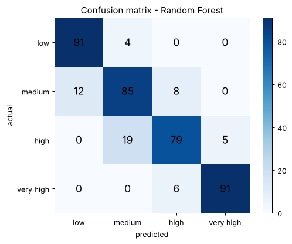
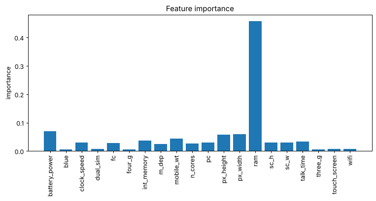

# Random Forest (Multi-class Classification)

Predicting the **price range of a mobile phone** (4 classes) using a **Random Forest**.
The validation set is used to choose the number of trees and the max depth, and the metrics are implemented with NumPy.

## Dataset
[Mobile Price Classification](https://www.kaggle.com/datasets/iabhishekofficial/mobile-price-classification) from Kaggle (`train.csv`).

| Property | Value |
|---|---|
| Samples | 2000 phones |
| Features | 20 (battery_power, ram, px_height, px_width, int_memory, ...) |
| Target | `price_range`: 0 = low, 1 = medium, 2 = high, 3 = very high |
| Classes | 500 phones in each class (balanced) |

## Repository structure
```
├── data/
│   └── train.csv
├── notebooks/
│   └── random_forest.ipynb
├── images/
│   ├── confusion_matrix.png
│   └── feature_importance.png
├── requirements.txt
└── README.md
```

## Method
1. **Split:** 60% train (1200), 20% validation (400), 20% test (400)
2. **Tuning:** 12 combinations tried (trees: 10, 50, 100 × max depth: 2, 3, 5, None), best one chosen by validation accuracy
3. **Evaluation (test set):** Accuracy, macro Precision, Recall and F1, confusion matrix

## Results
Best settings: **100 trees, max_depth = None**

| Set | Accuracy |
|---|---|
| Train | 1.000 |
| Validation | 0.865 |
| Test | 0.865 |

| Test Precision | Test Recall | Test F1 |
|---|---|---|
| 0.867 | 0.868 | 0.867 |





- Most mistakes are between neighbouring price ranges (e.g. medium vs high); low and very high are never confused.
- **RAM** is by far the most important feature.
- Train accuracy is 100% but validation is 86.5%, so the forest overfits a little.

## How to run
```bash
pip install -r requirements.txt
jupyter notebook notebooks/
```
